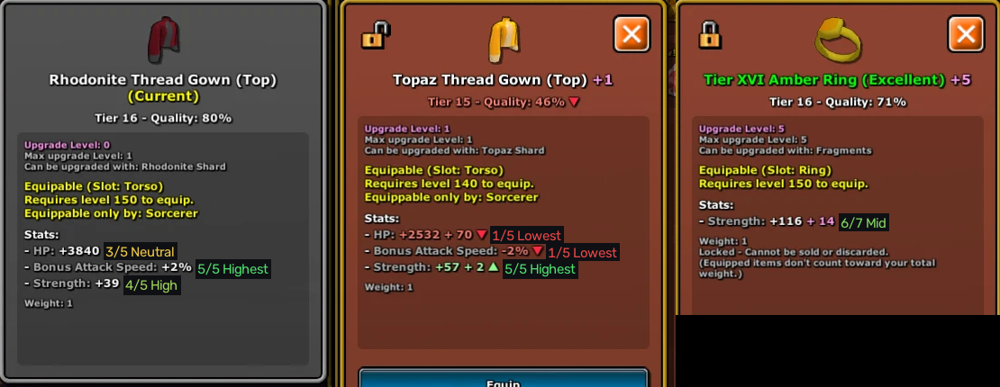

# Eterspire Roll Viewer

When you open an item in **Eterspire**, this small Windows app writes the roll of every stat
right next to it, in the game, so you can see at a glance what makes up the item's quality:



| Item | Stats | Rolls |
| --- | --- | --- |
| Weapons | Damage, Bonus Attack Speed, Vitality | 1 Lowest, 2 Low, 3 Neutral, 4 High, 5 Highest |
| Armor | HP, Bonus Attack Speed, Strength | 1 Lowest, 2 Low, 3 Neutral, 4 High, 5 Highest |
| Rings | Strength, Vitality | 1 to 3 (the -3, -2, -1 rolls), 4 None, 5 Low, 6 Mid, 7 High |

It works for items you're viewing, items you're wearing, and both sides of a comparison.
A stat that isn't listed (a neutral roll) is shown next to **Stats:** as *hidden*, since it
still counts toward the quality. Labels are green for good rolls, yellow for average, red for bad,
and grey when the app isn't sure.

The app has no window of its own: only an icon in the notification area (*Pause* / *Quit*).
Labels only show while the game is the active window, mouse clicks go straight through them,
and the app never touches the game itself: it only reads what's on screen.

## Getting started

**Option A: the .exe.** Download `EterspireRollViewer.exe` from the [Releases](../../releases) page
and double-click it. Nothing to install.

> Windows SmartScreen may warn about an unknown app the first time; click *More info → Run anyway*.

**Option B: from the source code.** Install [Python 3.10+](https://www.python.org/downloads/)
(tick *Add python.exe to PATH*), then double-click `run.bat`. The first start takes a minute to
install what it needs.

Requirements: Windows 10 (version 2004 or newer) or Windows 11, with an English language pack
(it's there if Windows is in English; otherwise add *English* in *Settings → Time & language*),
because the app uses the text recognition built into Windows. The game must not be minimized.

## How the rolls are worked out

Weapons and armor: `quality = sum of the 3 rolls / 15`, rounded down. For example
*Ominous Thread Boots, 80%*: Bonus Attack Speed +1% is High (4), Strength +81 is Highest (5),
so HP must be Neutral (3): (3 + 4 + 5) / 15 = 80%.

- **Bonus Attack Speed** has the same values at every tier: High / Highest are 1% / 2% on armor
  and 5% / 10% on weapons (3% / 4% and 7% / 12% on Excellent items). Negative values are Low / Lowest,
  0 or no line is Neutral.
- **Strength** (armor) and **Vitality** (weapons) work the same way, with values that depend on the tier:
  for example Strength is 3 / 4 at Tier 4, 49 / 81 at Tier 18 and 109 / 182 at Tier 22. The app knows them
  for every tier from 1 to 22, normal and Excellent. Where a value is missing (a few at Tiers 1-2) or for a
  tier newer than the table, the quality decides between High and Highest, and the label shows both in grey
  when it can't. Lines that don't count toward quality, like *Dark Resistance Level*, get no label.
- **Damage** and **HP** values change between game updates, so they're not read from a table:
  their roll is what's left of the quality once the two other rolls are known.
  Excellent items only roll 3 to 5 on Damage/HP.

Rings: `quality = sum of the 2 rolls / 14`, rounded down, and both stats come from the ring table
(Tier I to XVI and Ring of Darkness; Excellent rings are one tier ahead). For example
*Tier XVI Amber Ring (Excellent), 71%*: Strength 116 is Mid (6), no Vitality is None (4): 10 / 14 = 71%.

When the rolls can't add up to the quality shown (usually a misread number), the label gets a `?`.
When several rolls fit, the label shows them all, like `3-5/5`.

All values live in [`roll_viewer/data/rolls.json`](roll_viewer/data/rolls.json), taken from
[eterspire.wiki](https://eterspire.wiki/). If an update changes them, that's the only file to edit. The gear values
can be regenerated from a spreadsheet of the wiki's Bonus Stats tables (one row per set, one column per stat) with
`python tools/import_bonus_stats.py gear-bonus-stats.xlsx`, which also checks that sets of the same tier agree.

## Options

`run.bat` and the .exe accept a few options (for example in a shortcut's *Target*):

| Option | Default | |
| --- | --- | --- |
| `--title NAME` | `Eterspire` | Title of the game window |
| `--interval S` | `0.4` | Seconds between two reads of the screen |
| `--verbose` | off | Write every reading problem to the log |
| `--debug` | off | Also show labels when the game isn't the active window, and in screenshots |

The log is in `%APPDATA%\EterspireRollViewer\roll-viewer.log`.

## For developers

```bat
py -3 -m venv .venv
.venv\Scripts\pip install -r requirements.txt pytest
.venv\Scripts\python -m pytest
.venv\Scripts\python tools\read_screenshot.py tests\screenshots\*.png --save annotated
```

`tools/read_screenshot.py` runs the whole reading on screenshots and prints what was read, which is
the quickest way to check a new tooltip layout. `build.bat` builds `dist\EterspireRollViewer.exe`.

How it reads the screen (`roll_viewer/reader.py`): the game window is captured even when covered,
the whole frame goes through Windows OCR once to find each tooltip's *Stats:* line, then every text row
of the tooltip is cut out, cleaned (text vs. panel colour, so grey, brown and red panels all work),
enlarged and read again, which is much more reliable on the game's small font.
